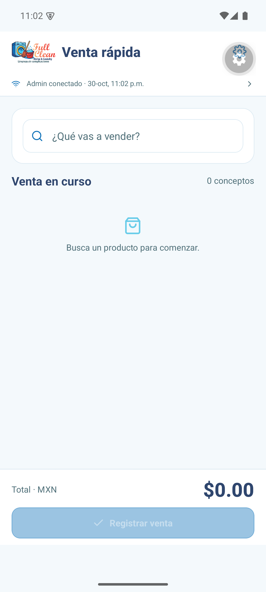
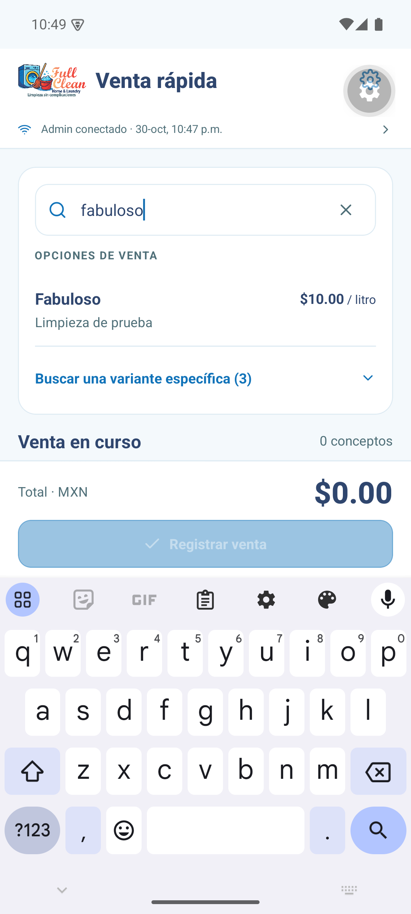
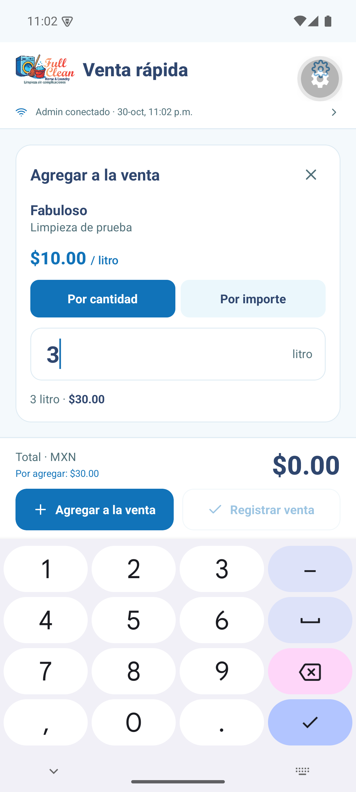
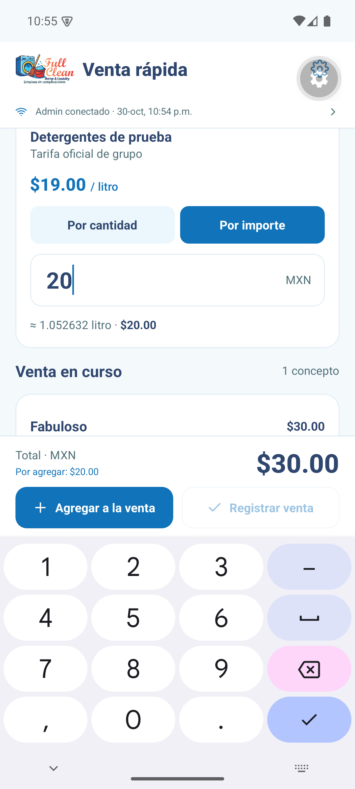
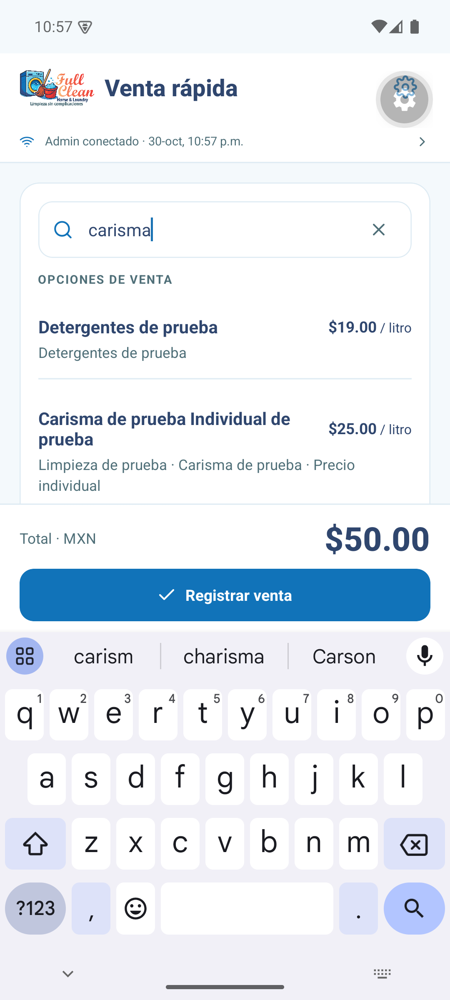
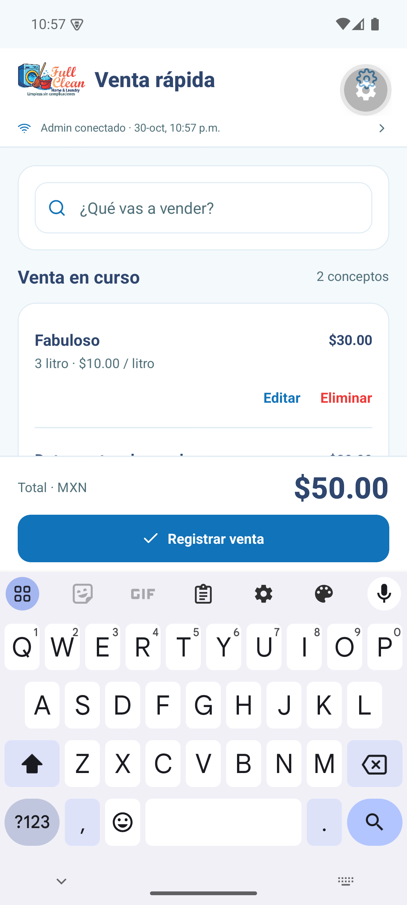
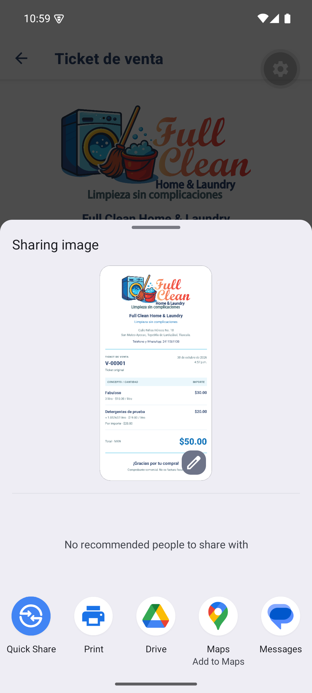
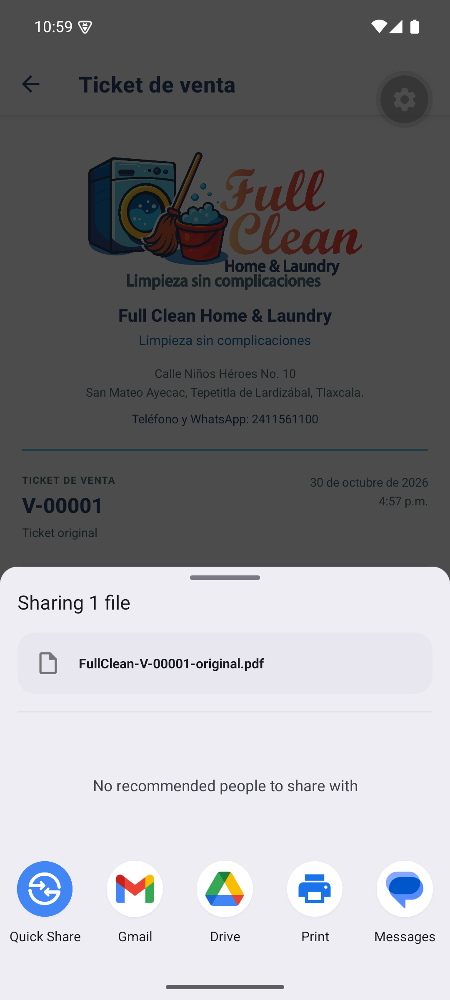
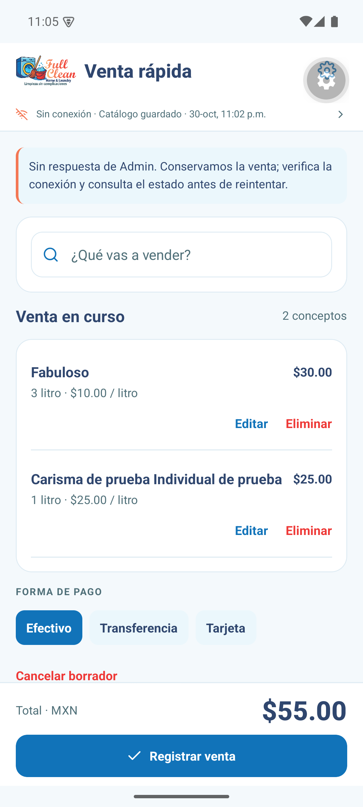
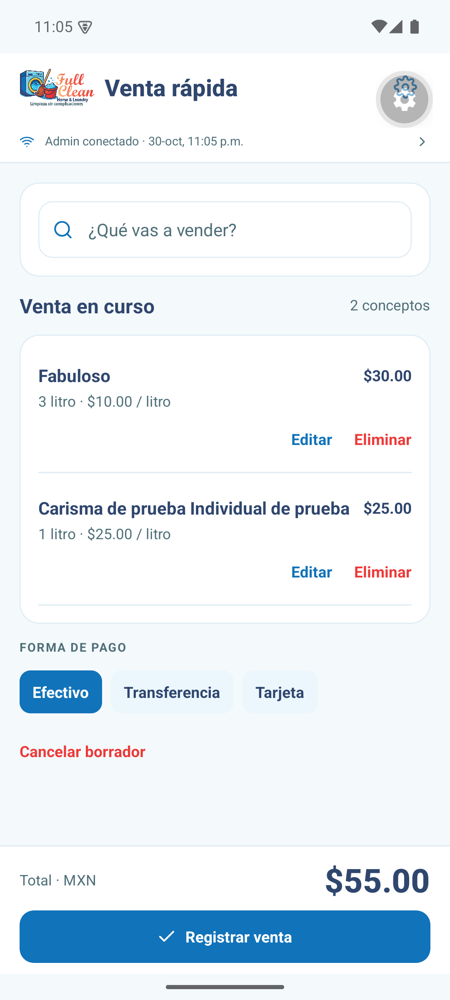

# Capturas y muestras del rediseño

Evidencia del emulador con datos sintéticos. Se abrieron los menús de compartir sin enviar archivos.

| Inicio limpio | Búsqueda comercial |
|---|---|
|  |  |

| Cantidad con teclado | Importe con teclado |
|---|---|
|  |  |

| Nombres ambiguos | Venta mixta |
|---|---|
|  |  |

| Compartir PNG | Compartir PDF |
|---|---|
|  |  |

| Reinicio sin API | Reconexión |
|---|---|
|  |  |

Muestras generadas en Android: [PNG de $50](tickets/FullClean-MUESTRA.png), [PDF de $50](pdf/FullClean-MUESTRA.pdf), [PNG de 32 conceptos](tickets/FullClean-MUESTRA-32-conceptos.png) y [PDF de 32 conceptos](pdf/FullClean-MUESTRA-32-conceptos.pdf).

El ticket largo conserva 32 conceptos y total $130: PNG 1080 × 7491 y PDF de tres páginas, todas revisadas.

[Resumen técnico, pruebas y uso por Wi-Fi](../docs/REDISENO_Y_TICKET.md).

APK firmado instalado y abierto: [pantalla inicial](screenshots/17-apk-instalado.png).
